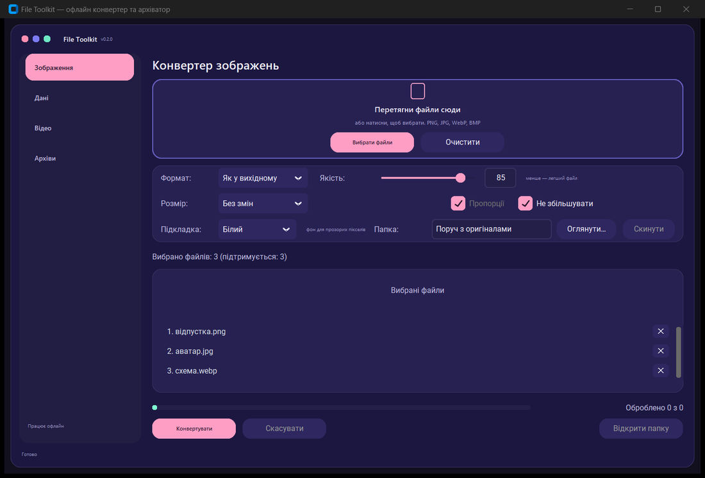
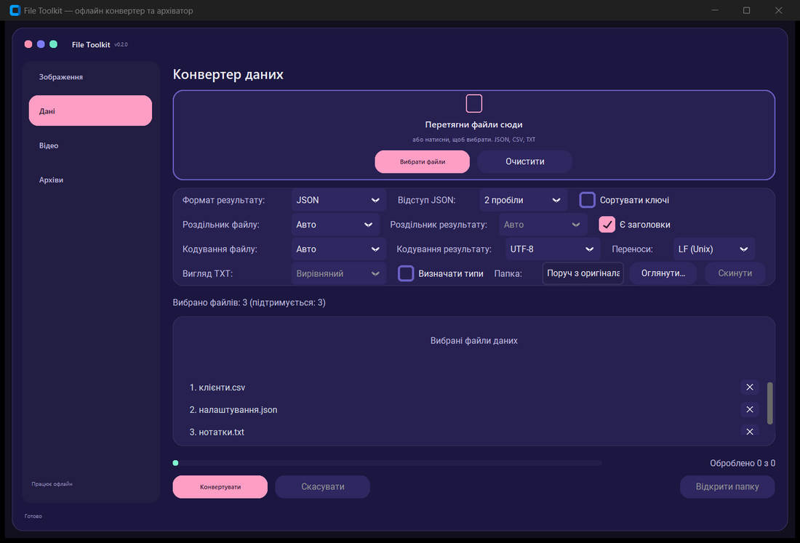
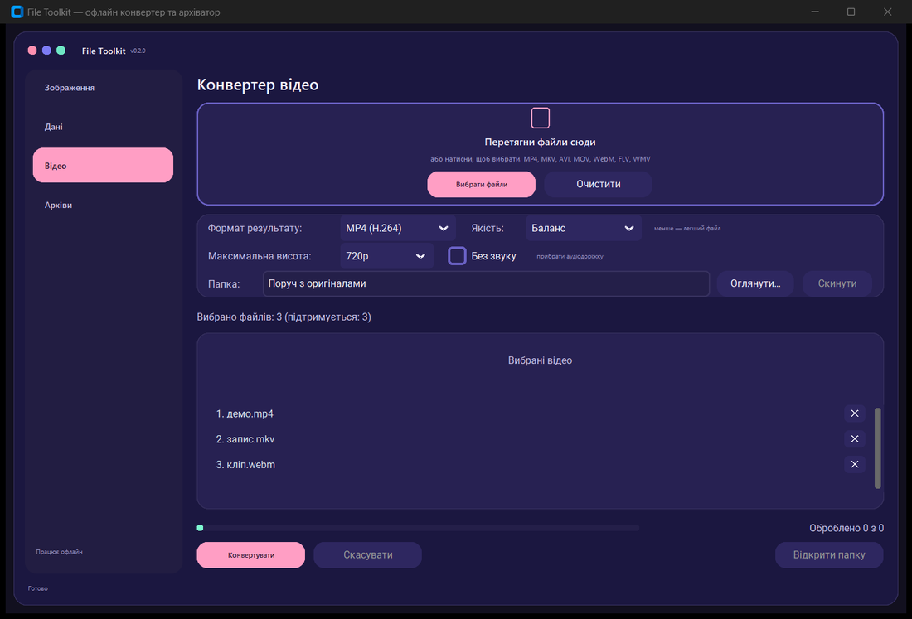
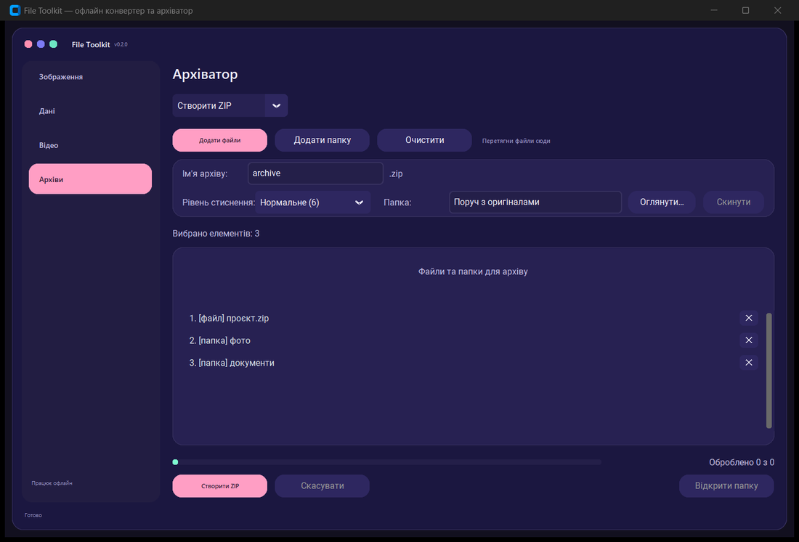

# File Toolkit

A small Windows desktop app for everyday file chores: converting images, data
files and video, and packing or unpacking archives. It works completely
offline — no files are ever uploaded anywhere, and nothing needs a network
connection at runtime.

Built with Python and [customtkinter](https://github.com/TomSchimansky/CustomTkinter),
packaged with PyInstaller.

## Screenshots

| Images | Data |
| --- | --- |
|  |  |

| Video | Archives |
| --- | --- |
|  |  |

## Features

### Drag and drop
Files can be dropped onto the highlighted area of the Images, Data and Video tabs, and
onto the toolbar of the Archives tab (one archive in extract mode, files and folders in
ZIP mode) instead of using the file picker. Dropped files behave exactly like manually
selected ones, so unsupported formats are added to the list and highlighted rather than
silently rejected. Drops are ignored while a job is running.

Each row in the Images, Data, Video and Archives lists has a `✕` button that removes
just that item, while the counter and unsupported-format highlights update right away.

### Images
- Convert between PNG, JPG, WebP and BMP in any direction.
- Keep the source format ("Same as source") or pick a target explicitly.
- Quality slider for JPG/WebP and compression level for PNG.
- Resize by longest side, by percentage or to an exact box, with an optional
  "do not upscale" guard.
- Transparency is flattened onto a chosen background colour for JPG/BMP.
- EXIF orientation is applied, EXIF/ICC metadata is preserved when possible.
- Originals are never overwritten: new names get `_1`, `_2` suffixes, files are
  written atomically through a temporary file.

### Data
- Convert JSON, CSV and TXT in any direction.
- Encoding is detected automatically (BOM, UTF-8, Windows-1251, latin-1) and the
  CSV delimiter is guessed; both can be set manually.
- Choose output encoding, BOM and line endings (LF/CRLF).
- JSON indent levels (none, 2, 4, 8) and optional key sorting.
- Optional type detection for CSV/TXT → JSON — off by default, so values such as
  `007` or phone numbers stay text.
- TXT can be rendered as aligned columns or with a custom delimiter.

### Video
- Input: MP4, MKV, AVI, MOV, WebM, FLV, WMV.
- Output: MP4 (H.264 + AAC), WebM (VP9 + Opus), MKV, animated GIF, or audio only
  as MP3/WAV.
- Quality presets, maximum height (480p/720p/1080p/unchanged) and a "no sound"
  option; GIF is always silent, MP3/WAV ignore height, WAV ignores quality.
- Duration and streams are read with `ffmpeg -i`, progress comes from
  `ffmpeg -progress`, and cancelling stops the process and deletes the partial
  file.

### Archives
- Create ZIP archives from files and folders, keeping the folder structure.
- Compression levels: store, fast, normal, maximum; empty folders are kept.
- Extract ZIP, TAR, TAR.GZ, TAR.BZ2, TAR.XZ and 7z into a new subfolder named
  after the archive.
- Zip Slip protection, password-protected ZIP detection, size/file-count limits,
  symlinks and hard links are skipped and reported.
- Name collisions are resolved with `_1`, `_2` instead of overwriting.

All long operations run in a background thread, show a progress bar with the
current file name, can be cancelled, and end with a summary listing failures.

## Requirements

- Windows 10/11
- Python 3.11 or newer (only for running from source)

## Run from source

```powershell
python -m venv venv
.\venv\Scripts\activate
pip install -r requirements.txt
python main.py
```

## Build a standalone .exe

The build script creates a `--onedir` bundle with a windowed (no console)
executable:

```powershell
.\venv\Scripts\activate
pip install -r requirements-build.txt
python build.py
```

Result: `dist\FileToolkit\FileToolkit.exe` (about 127 MB, most of it is the
bundled ffmpeg binary). The PyInstaller `.spec` file is generated inside
`build/` and is not tracked by git; `build/` and `dist/` are ignored as well.

The packaged app can verify itself without opening a window:

```powershell
.\dist\FileToolkit\FileToolkit.exe --self-test C:\Temp\report.txt
```

It converts a test image, data file, archive and video in a temporary folder and
writes the results to the report file.

## Project structure

```
main.py                    entry point, also --self-test for the packaged app
build.py                   PyInstaller build (onedir, no console)
requirements.txt           runtime dependencies
requirements-build.txt     build-only dependencies (PyInstaller)
app/
  ui.py                    window, sidebar, tabs, background workers
  converter.py             image conversion logic
  data_converter.py        JSON/CSV/TXT conversion logic
  video_converter.py       ffmpeg-based video and audio conversion
  archive.py               ZIP creation and archive extraction
tests/                     unittest suite for the logic and UI helpers
docs/screenshots/          screenshots used in this README
```

The logic modules do not import the UI, so they can be tested on their own:

```powershell
.\venv\Scripts\python.exe -m unittest discover -s tests
```

## Offline by design

The app never makes network requests. ffmpeg ships inside the
`imageio-ffmpeg` wheel, so even video conversion works with no internet access
and no system-wide ffmpeg installation.

## Note on ffmpeg

Video and audio conversion is delegated to FFmpeg, invoked as a separate
process. The binary comes from the
[`imageio-ffmpeg`](https://github.com/imageio/imageio-ffmpeg) wheel (the Python
package itself is BSD-2-Clause). FFmpeg is a separate project distributed under
the LGPL/GPL, and the bundled build may include components under either license
depending on how it was configured. If you redistribute this app (or the built
`.exe`) you are responsible for complying with FFmpeg's license terms and for
providing the corresponding license notices and source offer.

Other third-party components keep their own licenses: customtkinter (MIT),
Pillow (MIT-CMU), py7zr (LGPL-2.1).
